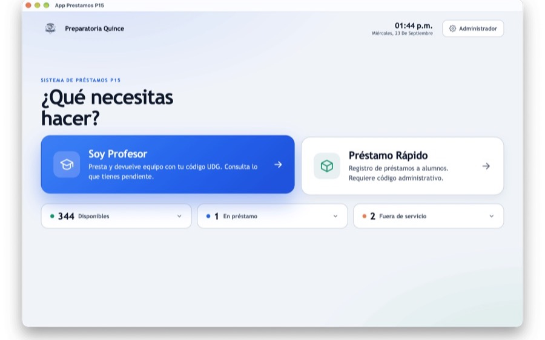
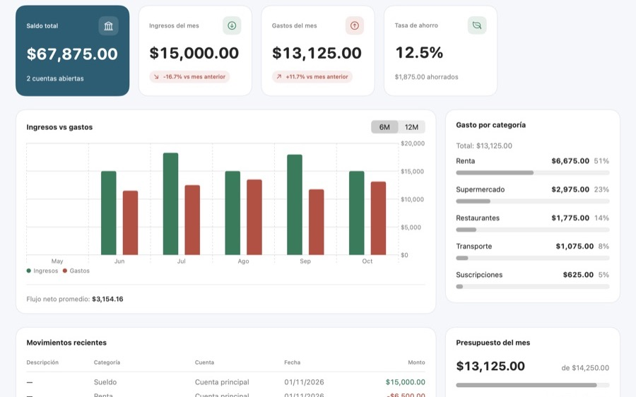
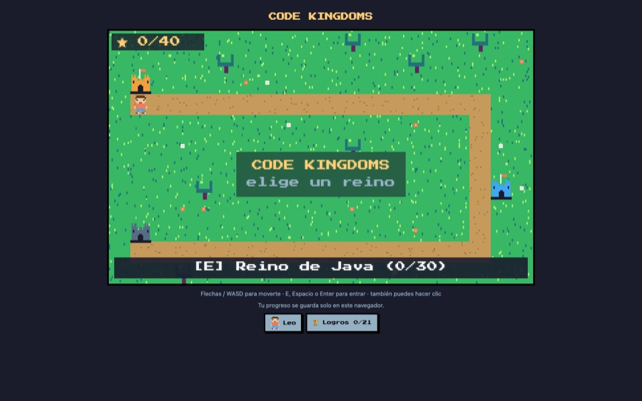

<h1 align="center">Hi, I'm Leo 👋</h1>

  <b>Computer Engineering student @ CUCEI · Universidad de Guadalajara</b> 
  Full-stack developer — React · Next.js · Tauri · Rust · Supabase 
  I build software that ends up in production, not in a folder.

  <a href="https://leonardogonzalezcv.netlify.app/">Portfolio</a> ·
  <a href="https://www.linkedin.com/in/leonardo-glez-dev/">LinkedIn</a> ·
  <a href="mailto:leoeligr10@gmail.com">Email</a>

---

<table>
  <tr>
    <td align="center" width="33%"> <b>app-prestamos-p15</b> · equipment lending in production</td>
    <td align="center" width="33%"> <b>finanzas</b> · native macOS app + MCP server</td>
    <td align="center" width="33%"> <b>code-kingdoms</b> · pixel-art game to learn to code</td>
  </tr>
</table>

## 🚀 What I've shipped

| Project | What it does | Impact | Stack |
| --- | --- | --- | --- |
| [app-prestamos-p15](https://github.com/Leoglez10/app-prestamos-p15) | Desktop inventory & equipment-lending system for Preparatoria 15 (UdeG) | **100+ teachers**, **1,000+ devices**, automated PDF reports | Tauri · React · TypeScript · SQLite |
| [Tae-Foto-P15](https://github.com/Leoglez10/Tae-Foto-P15) | Fully offline desktop app for photo & A/V equipment lending | **~120 students** across 4 groups, zero internet required | Tauri · Rust · SQLite |
| GeneradorSocioeconomicosNexplea | Web platform that turns socioeconomic study intake into branded PDF reports for an HR company | AI data extraction, voice dictation, photos and attached PDFs merged into one report | React · Vite · Node.js · Puppeteer · Firebase · Gemini · Docker |
| [guanajuatonosune.org](https://guanajuatonosune.org) | Public web platform for the State of Guanajuato | Live in production, presented at official press conferences | React · forms + database |
| [xignis-app](https://github.com/Leoglez10/xignis-app) | HR app for leave & absence requests: 4 roles, 2-level approval | Android/iOS build with CI, Vitest + Playwright | React · TypeScript · Capacitor · Supabase |
| [finanzas](https://github.com/Leoglez10/finanzas) | Native macOS personal finance app: envelope budget, scheduled payments, bundled MCP server | AI assistants can read and log spending; fully local, no cloud | Swift · SwiftUI · SwiftData · MCP |

**Side projects** — [smart-home-local](https://github.com/Leoglez10/smart-home-local) (WiZ lights from the macOS menu bar, no cloud)

**Open source** — [PR #633](https://github.com/Louis-CFM/coucou/pull/633) to [coucou](https://github.com/Louis-CFM/coucou), a macOS notch companion for coding agents: Pi sessions in the notch and an OpenCode Go chat provider (in review)

## 🧰 Stack

**Frontend** — React · Next.js · TypeScript · Tailwind CSS · Vite · React Native (Expo)
**Backend & data** — Node.js · Python · PHP · Supabase · Firebase · PostgreSQL · MySQL · SQLite
**Desktop & mobile** — Swift · SwiftUI · SwiftData · Tauri · Rust · Capacitor
**Infra & tooling** — Docker · Git · GitHub Actions · Vitest · Playwright · Linux

## 🤖 How I work

I lean hard on AI coding agents: custom skills, workflows and end-to-end automations used to design architecture and ship faster. I publish my skills as [agent-skills](https://github.com/Leoglez10/agent-skills), an LLM-first `SKILL.md` collection for Claude Code, OpenCode and Codex. I also come from hands-on hardware and software debugging, which is where I learned to read systems end-to-end instead of guessing.

## 📌 Currently

- Final year of Computer Engineering @ CUCEI (UdeG)
- Independent full-stack developer collaborating with **Nexplea** on projects (not an employee)
- **Open to internships and junior full-stack roles** — Guadalajara or remote

## 🐍 Contributions

<picture>
  <source media="(prefers-color-scheme: dark)" srcset="https://raw.githubusercontent.com/Leoglez10/Leoglez10/output/github-contribution-grid-snake-dark.svg" />
  <source media="(prefers-color-scheme: light)" srcset="https://raw.githubusercontent.com/Leoglez10/Leoglez10/output/github-contribution-grid-snake.svg" />
  
</picture>

---

ES · Estudiante de Ingeniería en Computación en CUCEI (UdeG) y desarrollador full-stack en Guadalajara. Construyo aplicaciones web y de escritorio que ya están en producción para escuelas, empresas y gobierno.

